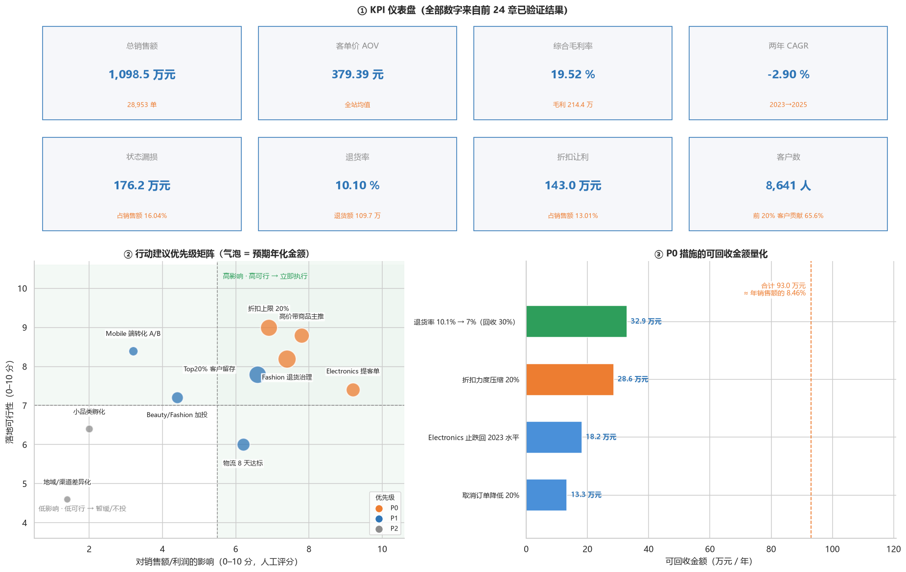
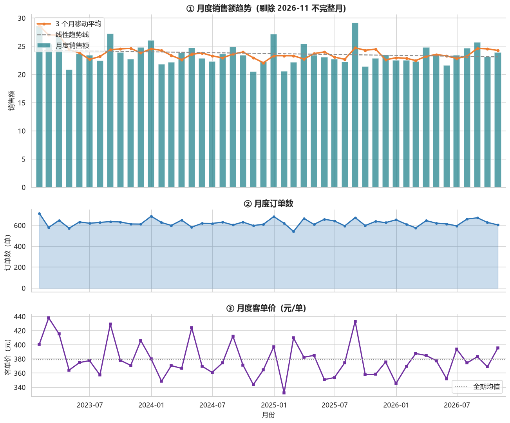
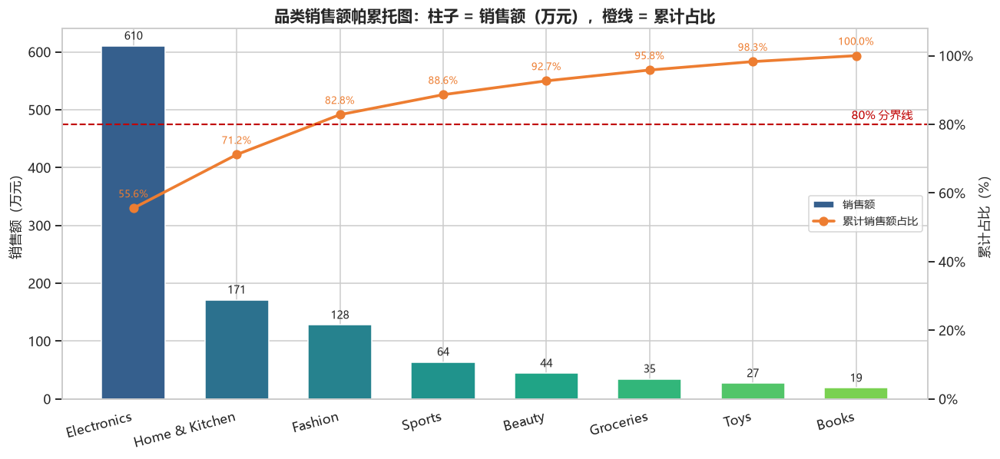
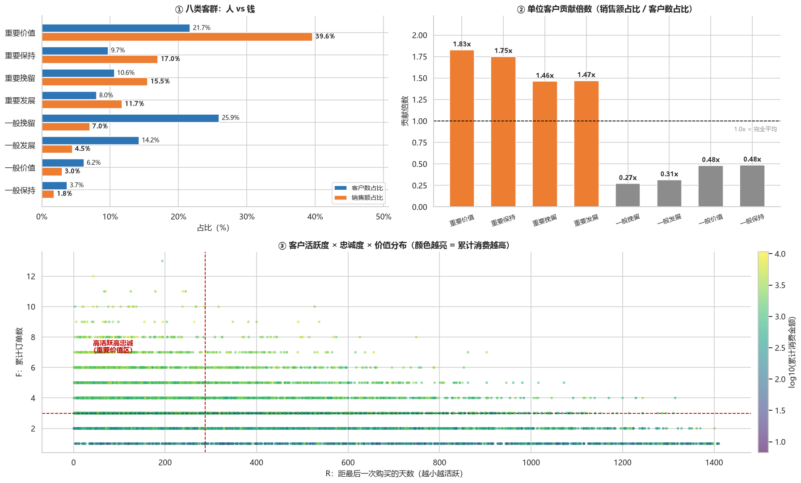
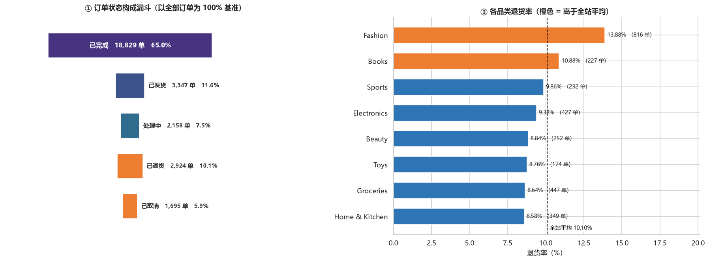
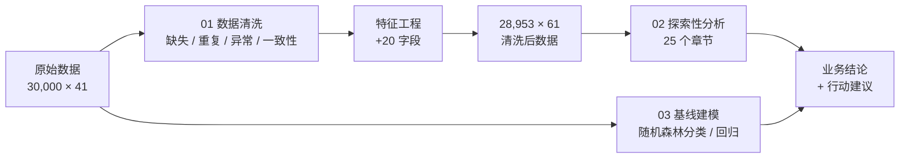

# 电商订单数据集分析

> 基于 Kaggle 公开数据集《E-Commerce Orders Dataset 2026》的端到端电商经营分析：
> **数据清洗 → 特征工程 → 探索性分析（EDA）→ 基线建模**，全部过程保留在可复现的 Jupyter Notebook 中。


---

## 一、项目概览

| 指标 | 数值 | 指标 | 数值 |
| --- | --- | --- | --- |
| 总销售额 | **1,098.5 万元** | 订单数 | **28,953 单** |
| 总利润 | **214.4 万元** | 客单价 AOV | **379.39 元** |
| 综合毛利率 | **19.52%** | 件单价 | 123.11 元/件 |
| 退货率 | **10.10%** | 平均折扣率 | 12.59% |
| 平均评分 | 4.04 / 5 | 高价值订单占比 | 25.10% |
| 下单客户数 | **8,641 人** | 人均下单 | 3.35 单/人 |

- **原始数据**：30,000 行 × 41 列，订单日期跨度 2023-01-01 ~ 2026-11-10
- **清洗后数据**：28,953 行 × 61 列（新增 5 个异常标记、8 个衍生特征、3 个截尾字段）
- **分析口径**：订单级（1 行 = 1 笔订单），金额单位为元，图表大额数字以「万元」展示

---

## 二、核心结论

1. **盘子稳定但增长停滞**：按同期口径（每年 1 月 1 日 ~ 11 月 10 日），销售额从 2023 年 253.1 万元到 2026 年 243.2 万元，**CAGR 为 -1.32%**，属于「存量维持」而非增长；毛利率四年稳定在 19.35% ~ 19.60%，盈利能力没有改善。
2. **结构高度集中**：8,641 位客户中，**前 20% 订单贡献了 65.63% 的销售额**（门槛 489 元）；客户 RFM 分层中，"重要价值 + 重要保持 + 重要挽留"三类客户用约 42% 的人数贡献了 72.1% 的销售额。
3. **漏损明显**：退货率 10.1% + 取消率 5.9% = 约 **16.04% 的销售额（176.2 万元）没有转化为有效收入**。
4. **折扣已成常态而非促销手段**：73.6% 的订单带折扣、68.1% 的订单使用优惠券，全年让利 **143.0 万元（占销售额 13.01%）**；但深折扣没有抬升客单价（无折扣 428.87 元 → 折扣 >30% 仅 297.72 元），也没有提高大额单占比，只是把毛利率从 22.28% 压到 13.59%——属于纯让利。
5. **品类策略分化**：Electronics 独占 55.57% 销售额，但毛利率仅 16.50%（全品类最低），是典型「以量换利」的现金牛；Fashion 退货率 13.88%（全站均值 10.10%）最高，是退货治理的首要方向；Beauty 毛利率 29.20% 最高却只占 4.03%，是最大的利润弹性来源。
6. **可执行空间已量化**：P0 级四项措施（Electronics 提客单、高价带主推、Fashion 退货治理、折扣上限 20%）预期年化可回收 **93.0 万元，约等于年销售额的 8.46%**，可将 16.04% 的状态漏损压缩到约 12.23%。

> 完整推导见 [notebooks/02_eda_analysis.ipynb](notebooks/02_eda_analysis.ipynb) 第 25 章「综合结论与行动建议」。

---

## 三、关键图表

**① 经营总览与行动优先级矩阵**



**② 月度销售趋势**



**③ 品类销售额排行与帕累托分析**



**④ 客户 RFM 分层：人 vs 钱**



**⑤ 订单状态漏斗与漏损结构**



其余图表（大额订单画像、驱动因素相关性等）见 `images/` 目录与 EDA notebook。

---

## 四、分析流程



| 阶段 | Notebook | 产出 |
| --- | --- | --- |
| 数据清洗与预处理 | [notebooks/01_data_cleaning.ipynb](notebooks/01_data_cleaning.ipynb) | `ecommerce_orders_cleaned.csv`、`cleaning_log.csv` |
| 探索性分析 | [notebooks/02_eda_analysis.ipynb](notebooks/02_eda_analysis.ipynb) | 25 章分析报告 + 24 张图表 + 管理层摘要 |
| 基线建模 | [notebooks/03_baseline_models.ipynb](notebooks/03_baseline_models.ipynb) | 高价值订单分类、订单金额回归基线 |

---

## 五、目录结构

```text
电商订单项目分析/
├── data/
│   ├── README.md                  # 数据来源与下载方式
│   ├── data_dictionary.csv        # 41 个原始字段字典
│   ├── cleaning_log.csv           # 清洗动作日志
│   ├── ecommerce_orders_dataset.csv     # 原始数据（不入库，需自行下载）
│   └── ecommerce_orders_cleaned.csv     # 清洗产物（不入库，运行 01 生成）
├── notebooks/
│   ├── 01_data_cleaning.ipynb     # 清洗 + 特征工程
│   ├── 02_eda_analysis.ipynb      # 探索性分析（25 章）
│   └── 03_baseline_models.ipynb   # 基线机器学习模型
├── images/                        # README 与报告用图
├── .gitattributes
├── .gitignore
├── LICENSE
├── README.md
└── requirements.txt
```

> 两个 CSV 数据文件被 `.gitignore` 排除，获取方式见 [data/README.md](data/README.md)。

---

## 六、EDA 章节结构

| 分组 | 章节 |
| --- | --- |
| 经营总览 | 2. 数据载入与结构体检 · 3. 核心经营指标总览 · 4. 月度销售趋势 · 5. 年度/同期对比 · 6. 年 × 月销售热力图 |
| 商品结构 | 7. 品类销售额 + 帕累托 · 8. 品类战略矩阵（销售额 × 毛利率 × 订单量）· 9. 子类 TOP10/BOTTOM10 · 10. 品牌表现 · 11. 价格带分析 |
| 大额订单 | 12. 人群维度画像 · 13. 渠道与行为维度画像 · 14. 金额分布与二八法则 · 15. 大额订单驱动因素 |
| 促销 | 16. 折扣与优惠券效果评估 |
| 客户 | 17. 客户 RFM 分层 · 18. 客户价值贡献帕累托结构 |
| 履约 | 19. 订单状态漏斗与退货分析 · 20. 物流时效对评分与退货的影响 |
| 地域与渠道 | 21. 地域市场表现 · 22. 流量渠道与设备分析 |
| 建模导向 | 23. 数值字段相关性矩阵 · 24. 销售前景判断 |
| 结论 | 25. 综合结论与行动建议（管理层摘要） |

---

## 七、快速开始

### 1. 克隆仓库

```bash
git clone <your-repo-url>
cd 电商订单项目分析
```

### 2. 准备数据

从 Kaggle 下载 `ecommerce_orders_dataset.csv`，放入 `data/` 目录。详见 [data/README.md](data/README.md)。

### 3. 创建环境

```bash
python -m venv .venv
# Windows
.venv\Scripts\activate
# macOS / Linux
source .venv/bin/activate

pip install -r requirements.txt
```

### 4. 按顺序运行

```text
notebooks/01_data_cleaning.ipynb    → 生成 data/ecommerce_orders_cleaned.csv
notebooks/02_eda_analysis.ipynb     → 读取清洗后数据，产出全部分析结论
notebooks/03_baseline_models.ipynb  → 基线模型（可直接读原始数据）
```

在仓库根目录启动 Jupyter：

```bash
jupyter lab
```

> Notebook 内部使用 `Path.cwd().parent` 定位项目根目录，
> 因此在 `notebooks/` 目录下（或在编辑器默认工作目录为 notebook 所在目录时）运行即可正确定位 `data/`。

### 中文字体提示

绘图代码已配置字体回退链：Windows 用微软雅黑/黑体，macOS 用苹方，Linux 用 Noto Sans CJK / 文泉驿。
Linux 环境若出现方块字，请安装：

```bash
sudo apt-get install fonts-noto-cjk
```

---

## 八、数据清洗要点

| 清洗动作 | 处理结果 |
| --- | --- |
| 删除未来日期订单 | 1,047 条 |
| 完全重复行 / Order_ID 重复 | 0 条 |
| 已取消订单：配送天数、评分置缺失 | 各 1,695 条 |
| 新增异常标记字段 | 5 个（价格/金额/配送天数分组异常、未来订单等） |
| 新增衍生特征字段 | 8 个（毛利、净额、单件金额、年月、是否周末、年龄段、价格带等） |
| 分位数截尾（Winsorize）字段 | 3 个（订单金额、利润、客户生命周期价值） |
| 最终保留下来的缺失单元格 | 3,390 个（均为业务性缺失，如已取消订单本身没有配送天数与评分） |

完整字段定义见 [data/data_dictionary.csv](data/data_dictionary.csv) 与 01 号 notebook 第 21 节。

---

## 九、方法口径与局限

- **同期对比**：2026 年数据仅到 11 月 10 日，年度对比统一采用「每年 1 月 1 日 ~ 11 月 10 日」口径，避免不完整年份失真。
- **异常值**：同时使用 IQR 与 3σ 双方法检测，标注而非直接删除；对金额类字段采用 1%/99% 分位数截尾（保留原始列 + `*_Winsor` 列）。
- **ROI 估算**：P0/P1/P2 的可回收金额基于假设口径（如退货率 10.1% → 7%、折扣压缩 20%），落地前需用真实成本与退货原因数据复核。
- **数据局限**：`Country`/`City` 无真实地理从属关系；`Traffic_Source`/`Device_Type`/`Brand`/`Age` 近似均匀分布，其"无差异"结论反映数据生成方式而非业务规律；数据集缺少成本明细、退货原因码与漏斗数据。

---

## 十、许可证与致谢

- 代码与文档：[MIT License](LICENSE)
- 数据集：Kaggle 公开数据集《E-Commerce Orders Dataset 2026》，版权归原始发布方所有，使用请遵守其页面条款。

如果这个项目对你有帮助，欢迎 Star ⭐
